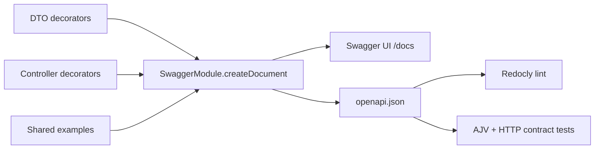

# ПР 5. OpenAPI і документація контракту

**GitHub:** [Crack8754/PR5](https://github.com/Crack8754/PR5)

Продовження API з ПР3–ПР4: ті самі ProjectsModule, ProjectsController, ProjectsService та repository port. Додано @nestjs/swagger 11 (сумісний із NestJS 11), Swagger UI, перевірний OpenAPI 3.0 документ, приклади й контрактні тести.

## Що подати

| Артефакт | Де знайти |
| --- | --- |
| Swagger UI | [http://localhost:3000/docs](http://localhost:3000/docs), після запуску сервера |
| OpenAPI JSON | [openapi.json](./openapi.json), також [HTTP endpoint](http://localhost:3000/openapi.json) |
| Приклади | [examples/projects.http](./examples/projects.http) та JSON-файли в examples/ |
| Bearer scheme | components.securitySchemes.bearer в openapi.json |
| Результат lint | [reports/openapi-lint.json](./reports/openapi-lint.json) |
| GitHub | [https://github.com/Crack8754/PR5](https://github.com/Crack8754/PR5) |

## Запуск

Потрібні Node.js **22.12+** та npm **10+** (вимоги інструментів документації).

```
npm ci
npm run build
npm start
```

Відкрийте [Swagger UI](http://localhost:3000/docs). Оберіть операцію → **Try it out** → **Execute**.
Спочатку виконайте POST, потім використайте отриманий ID для GET/PATCH/DELETE.
Повторний POST з тією самою назвою поверне 409.

Якщо порт 3000 зайнятий попередньою практичною роботою:

```
$env:PORT = '3005'
npm start
```

Тоді UI доступний за [http://localhost:3005/docs](http://localhost:3005/docs).
В OpenAPI використано відносний server URL `/`, тому Try it out працює на поточному порту.

## Перевірка документа

```
npm run openapi:generate
npm run verify
```

| Команда | Призначення |
| --- | --- |
| npm run openapi:generate | Компілює код, генерує openapi.json та JSON-приклади з єдиного джерела |
| npm run openapi:check | Перевіряє, що збережені документ і приклади точно відповідають поточному коду |
| npm run openapi:lint | Запускає Redocly CLI з recommended rules і перевіркою прикладів |
| npm test | Запускає HTTP, DI, repository та OpenAPI contract тести |
| npm run verify | Послідовно запускає перевірку актуальності, lint і тести |

Lint-скрипт завершується невдало за наявності **хоча б одного warning або error**. Правила не вимикаються, попередження не приховуються. JSON-звіт зберігається в reports/openapi-lint.json.

Результат перевірки: **0 errors, 0 warnings; 14 тестів пройшли**.
Тести перевіряють HTML та assets Swagger UI, рівність HTTP-документа з openapi.json, схеми й приклади, фактичний CRUD, 400/404/409/413/500, серіалізацію та відсутність авторизації. Для контрактних перевірок використано AJV.

## Bearer security scheme

```json
{
  "components": {
    "securitySchemes": {
      "bearer": {
        "type": "http",
        "scheme": "bearer"
      }
    }
  },
  "security": [
    {},
    { "bearer": [] }
  ]
}
```

Кнопка **Authorize** дозволяє передати токен, після чого Swagger UI додає заголовок `Authorization: Bearer <token>`.

**Перевірки токенів у ПР3–ПР5 немає.** Схема документує необов’язковий заголовок і не захищає API. Порожня альтернатива `{}` означає, що дозволений анонімний доступ. Не задекларовано вигадану відповідь 401 або JWT-валидацію. Це перевіряється HTTP-тестами як без заголовка, так і з довільним токеном.

## Operations та schemas

Усі п’ять операцій мають tag **Projects**, унікальний operationId, summary, description, параметри та response status codes.

| Метод | Шлях | Успіх | Помилки |
| --- | --- | --- | --- |
| POST | /projects | 201 + ProjectResponseDto | 400, 409, 413, 500 |
| GET | /projects | 200 + ProjectResponseDto[] | 400, 413, 500 |
| GET | /projects/{id} | 200 + ProjectResponseDto | 400, 404, 413, 500 |
| PATCH | /projects/{id} | 200 + ProjectResponseDto | 400, 404, 409, 413, 500 |
| DELETE | /projects/{id} | 204 без тіла | 400, 404, 413, 500 |

GET та DELETE не вимагають тіла. Їхні parser-помилки 400/413 описані на випадок, коли клієнт усе ж надсилає некоректне або завелике JSON-тіло: parser виконується перед контролером. Випадок GET із некоректним JSON перевірено окремим тестом.

Схеми:

- **CreateProjectDto:** name — рядок 3–100 символів після trim; description — необов’язковий рядок до 500 символів; status — обов’язкове draft/active/completed.
- **UpdateProjectDto:** ті самі поля й обмеження; усі необов’язкові, але потрібне принаймні одне (`minProperties: 1`).
- **ProjectResponseDto:** лише id, name, description, status, createdAt.
- **ApiErrorDto:** statusCode, errorCode, message, path, timestamp, traceId.

У схемах DTO встановлено `additionalProperties: false`. Це відповідає ValidationPipe для запитів і серіалізації для відповідей. Переданий null не дозволяється. У відповіді ID має тип integer, createdAt — date-time; traceId у помилці — uuid.

Назви унікальні після обрізання крайніх пробілів, з урахуванням регістру. Непередані PATCH-поля не змінюються. Порожній опис очищає його. ID у path перетворюється через ParseIntPipe; нечислове значення повертає 400.

## Приклад створення

Запит:

```http
POST /projects
Content-Type: application/json

{
  "name": "StudyFlow",
  "description": "Система керування навчальними проєктами",
  "status": "active"
}
```

Відповідь 201 (ID і час генерує сервер):

```json
{
  "id": 1,
  "name": "StudyFlow",
  "description": "Система керування навчальними проєктами",
  "status": "active",
  "createdAt": "2026-09-23T10:00:00.000Z"
}
```

Оновлення: `PATCH /projects/1` з `{"status":"completed"}` повертає 200 із повним DTO.
Видалення повертає 204 **без JSON-тіла**.
Внутрішні updatedAt, internalNote, deletedAt не виходять до клієнта.

## Помилки

```json
{
  "statusCode": 404,
  "errorCode": "PROJECT_NOT_FOUND",
  "message": "Project with id 10 was not found",
  "path": "/projects/10",
  "timestamp": "2026-09-23T10:00:00.000Z",
  "traceId": "550e8400-e29b-41d4-a716-446655440000"
}
```

Коди: VALIDATION_ERROR, BAD_REQUEST, EMPTY_UPDATE, PROJECT_NOT_FOUND, PROJECT_NAME_CONFLICT, PAYLOAD_TOO_LARGE, INTERNAL_SERVER_ERROR.
Невідомий маршрут повертає NOT_FOUND. traceId також передається в заголовку X-Trace-Id. Кілька помилок DTO об’єднуються в один рядок message.

Під час контрактної перевірки виправлено обробку стандартної body-parser помилки `entity.too.large`: тепер тіло понад 100 KB дає 413 у стандартному форматі, а не 500. Невідомі внутрішні помилки як і раніше повертають загальне повідомлення без стека.

## Структура документації

```text
src/
  openapi/
    swagger.ts                       # DocumentBuilder, bearer, Swagger UI
    examples.ts                      # Єдине джерело JSON-прикладів
    api-project-errors.decorator.ts  # Error responses, headers, examples
  common/dto/api-error.dto.ts
  projects/dto/                      # ApiProperty/ApiPropertyOptional
  projects/projects.controller.ts    # ApiTags/ApiOperation/ApiBody/ApiResponse
scripts/
  generate-openapi.cjs
  lint-openapi.cjs
test/
  projects.test.cjs
  openapi.test.cjs
examples/
reports/openapi-lint.json
redocly.yaml
openapi.json
```



Зберігання лишається in-memory. Після перезапуску дані й лічильник ID скидаються.

## Джерела

- [NestJS OpenAPI](https://docs.nestjs.com/openapi/introduction)
- [Redocly CLI lint](https://redocly.com/docs/cli/commands/lint)
